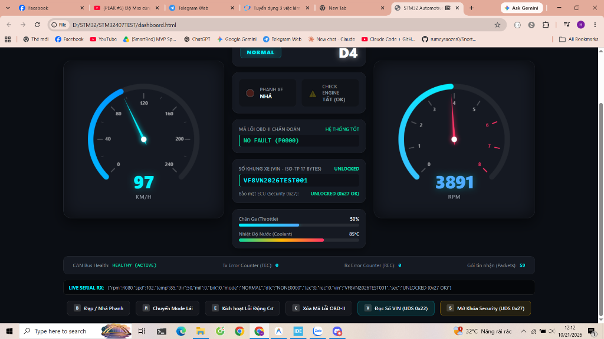
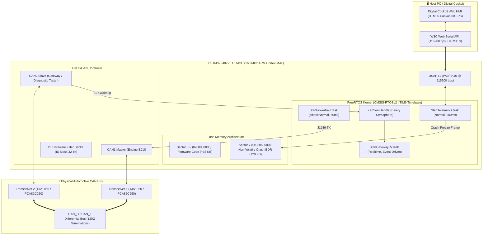
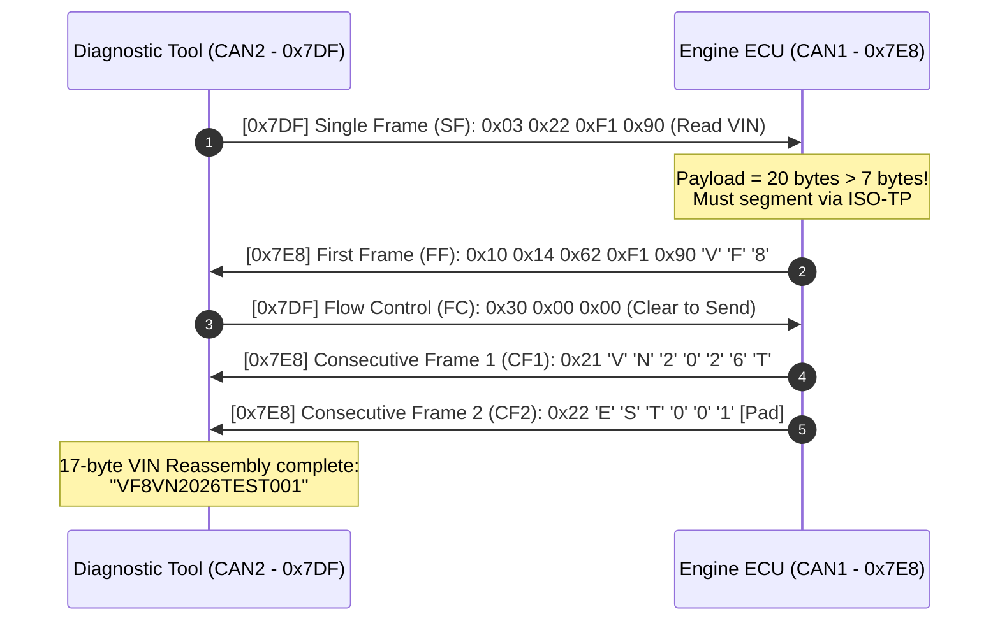

# Automotive Telematics & Digital Cockpit Gateway
### High-Performance Dual bxCAN, FreeRTOS Automotive Kernel, ISO 14229 (UDS), ISO 15765-2 (ISO-TP) & Web Serial HMI

-blue?logo=stmicroelectronics)


%20%7C%20ISO--TP%20(ISO%2015765--2)-red)


---

## 📌 Project Overview

This repository contains an end-to-end **Automotive Telematics & Digital Cockpit Gateway** implemented on an **STM32F407VET6** (ARM Cortex-M4F @ 168 MHz). 

The system models a modern automotive electronic architecture featuring:
1. **Engine / Powertrain ECU (CAN1)** broadcasting extended 29-bit **SAE J1939** packets.
2. **Telematics & Diagnostic Gateway (CAN2)** executing full multi-frame **ISO-TP (ISO 15765-2)** segmentation/reassembly and **UDS (ISO 14229)** services.
3. **Event Data Recorder (EDR / Crash Freeze Frame)** persistently writing accident parameters to non-volatile **Flash Sector 7**.
4. **Digital Cockpit Dashboard** rendering interactive automotive gauges at **60 FPS Canvas** via native browser **Web Serial API** without requiring third-party drivers or cloud servers.


*Figure 1: Digital Cockpit executing Phase 5 Hardware-in-the-Loop test: 97 km/h, D4 Gear, 17-byte VIN reassembled via ISO-TP, UDS 0x27 Security Access Unlocked, and zero CAN bus errors.*

---

## 🏗️ System Architecture



---

## 🚀 Key Engineering Highlights

### 1. Dual bxCAN & Hardware Filter Masking
- **Bit Timing Configuration:** APB1 Peripheral Clock = $42\text{ MHz}$, Prescaler = $6$, TimeSeg1 = $11\text{TQ}$, TimeSeg2 = $2\text{TQ}$.
  $$\text{Nominal Bit Time (NBT)} = 1 + 11 + 2 = 14\text{ TQ}$$
  $$\text{Baudrate} = \frac{42\text{ MHz}}{6 \times 14} = 500\text{ kbps}, \quad \text{Sample Point} = \frac{1 + 11}{14} \approx 85.7\%$$
- **Hardware 32-bit ID Masking:** Filter Bank 14 allocated to CAN2 with Pass-All mask configuration to capture both 29-bit J1939 Powertrain frames (`0x0CF00400`) and standard 11-bit UDS diagnostic responses (`0x7E8`) into FIFO0.
- **Hardware Error Counters (`CAN_ESR`):** Real-time monitoring of Transmit Error Counter (TEC) and Receive Error Counter (REC). Tested with physical wire-pull ($CAN\_L$) demonstrating automatic transition to *Bus-Off* and self-recovery back to *Active*.

### 2. Preemptive FreeRTOS Automotive Kernel
- **HAL Timebase Decoupling:** Replaced default `SysTick` timebase with general-purpose hardware timer **TIM6**, dedicating `SysTick` exclusively to FreeRTOS Scheduler context switching.
- **Event-Driven Semaphore Synchronization:** In `CAN2_RX0_IRQHandler`, frames unblock `StartGatewayRxTask` instantly via `osSemaphoreRelease()`, keeping CPU consumption at **0%** during bus idle states.

### 3. SAE J1939 Powertrain Protocol
- 29-bit Extended Identifier `0x0CF00400` decoded as:
  - **Priority:** 3
  - **PGN:** `0xF004` (Electronic Engine Controller 1 - EEC1)
  - **Source Address:** `0x00` (Engine ECU)
- Zero-overhead 8-byte payload compression using `__attribute__((packed))` combined with `union` and single-bit `bitfield` members:
  ```c
  typedef struct __attribute__((packed)) {
      uint16_t rpm;
      uint8_t  speed;
      uint8_t  coolant_temp;
      uint8_t  throttle;
      uint8_t  mil_lamp    : 1;
      uint8_t  overheat    : 1;
      uint8_t  drive_mode  : 2; // ECO, NORMAL, SPORT
      uint8_t  brake_pedal : 1;
      uint8_t  reserved    : 3;
      uint16_t dtc_code;
  } Powertrain_Data_t;
  ```

### 4. ISO-TP (ISO 15765-2) Multi-Frame Segmentation & Reassembly
Enables transmission of payloads exceeding Classical CAN's 8-byte boundary (e.g. 17-character VIN):
1. **Tester (`0x7DF`)** requests Read DID `0xF190` via Single Frame (`0x03 0x22 0xF1 0x90`).
2. **ECU (`0x7E8`)** detects payload length = 20 bytes $> 7$ bytes $\rightarrow$ transmits **First Frame (FF)**: `0x10 0x14 0x62 0xF1 0x90 'V' 'F' '8'`.
3. **Tester (`0x7DF`)** immediately replies with **Flow Control (FC: Clear To Send)**: `0x30 0x00 0x00`.
4. **ECU (`0x7E8`)** streams **Consecutive Frame 1 (CF1, PCI `0x21`)** and **Consecutive Frame 2 (CF2, PCI `0x22`)**.
5. **Gateway (`CAN2`)** reassembles the full string: `"VF8VN2026TEST001"`.



### 5. Unified Diagnostic Services (UDS - ISO 14229)
| Service ID | Service Name | Sub-function / Details |
| :--- | :--- | :--- |
| **`0x22`** | Read Data By Identifier | DID `0xF190`: Vehicle Identification Number (VIN) |
| **`0x27`** | Security Access | `0x01` Request Seed (`0x5A3C`) $\rightarrow$ `0x02` Send Key ($Key = Seed \oplus 0\text{xABCD}$) |
| **`0x19`** | Read DTC Information | `0x02` Report DTC by status mask \| `0x04` Report DTC Freeze Frame snapshot |
| **`0x14`** | Clear Diagnostic Info | Clears active RAM DTCs and erases persistent Flash Sector 7 EDR records |

### 6. Crash Event Data Recorder (EDR / Freeze Frame Logger)
- **Sector Isolation:** Uses **Sector 7 (`0x08060000`, 128 KB)**, ensuring complete physical separation from firmware application sectors (Sector 0-2).
- **Non-Volatile Persistence:** On sudden power loss or MCU hardware reset, crash telemetry (Speed, RPM, Throttle, Coolant Temperature, Brake state, DTC) is verified via magic key `0xA55A1234` and restored to the dashboard.

---

## 🔌 Hardware Pinout & Wiring

| Interface | STM32 Pin | Connected Peripheral | Electrical Details |
| :--- | :--- | :--- | :--- |
| **CAN1 RX** | `PA11` | Transceiver 1 RXD | 3.3V Logic |
| **CAN1 TX** | `PA12` | Transceiver 1 TXD | 3.3V Logic |
| **CAN2 RX** | `PB12` | Transceiver 2 RXD | 3.3V Logic |
| **CAN2 TX** | `PB13` | Transceiver 2 TXD | 3.3V Logic |
| **CAN Bus** | $CAN\_H / CAN\_L$ | Shared Differential Bus | **Two $120\,\Omega$ termination resistors** ($60\,\Omega$ equivalent) |
| **USART1 TX**| `PA9` | FT232 / USB-UART RX | 115200 bps, 8N1 |
| **USART1 RX**| `PA10`| FT232 / USB-UART TX | 115200 bps, 8N1 |
| **Common GND**| `GND` | Power & Transceiver GND | **Mandatory single ground reference** |

---

## 🛠️ Build & Installation Guide

### Prerequisites
- **IDE:** STM32CubeIDE v1.14+ or v2.2.0 (with `arm-none-eabi-gcc` toolchain)
- **Debugger:** ST-Link V2 / J-Link
- **Browser:** Google Chrome or Microsoft Edge (with Web Serial API enabled)
- **Terminal:** FT232 or CP2102 USB-to-UART adapter

### 1. Build the Firmware
Open the project in STM32CubeIDE or run via command line:
```bash
cd Debug
make -j8 all
```

Output binary: `Debug/STM32407TEST.elf` (approx. 38 KB Flash, 21 KB RAM).

### 2. Flash to STM32F407
- In STM32CubeIDE, click **Run** (`Ctrl + F11`) or **Debug** (`F11` followed by `F8` Resume).
- Press the physical **RESET** button on the STM32 board once after programming.

### 3. Launch Digital Cockpit
1. Open [`dashboard.html`](dashboard.html) directly in Google Chrome or Microsoft Edge.
2. Click **`🔌 KẾT NỐI COM18`** (select your FT232 serial COM port).
3. Interact via UI buttons or keyboard shortcuts:
   - <kbd>B</kbd>: Toggle Brake Pedal (Deceleration / Brake lights)
   - <kbd>M</kbd>: Cycle Drive Mode (`ECO` $\rightarrow$ `NORMAL` $\rightarrow$ `SPORT`)
   - <kbd>K</kbd>: 💥 Simulate Crash Event (Triggers emergency braking & writes Flash Sector 7 EDR)
   - <kbd>R</kbd>: 📡 Read Freeze Frame via UDS `0x19`
   - <kbd>C</kbd>: 🧹 Clear DTC & Erase Flash EDR via UDS `0x14`
   - <kbd>V</kbd>: 🔍 Read 17-byte VIN via ISO-TP & UDS `0x22`
   - <kbd>S</kbd>: 🔓 Execute Security Access Seed/Key handshake via UDS `0x27`

---

## 📄 License
This project is open-source and released under the MIT License.
