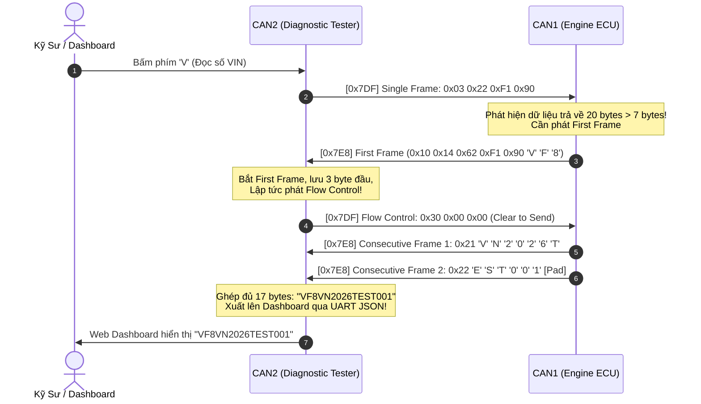

# SỔ TAY KỸ SƯ NHÚNG Ô TÔ (AUTOMOTIVE EMBEDDED HANDBOOK)
## Dự án: Automotive Telematics & Digital Cockpit Gateway (Phase 1 - 5)
**Vi điều khiển:** STM32F407VET6 (ARM Cortex-M4F @ 168 MHz)  
**Tác giả:** Kỹ sư Nhúng & IoT Thực chiến  
**Tiêu chuẩn áp dụng:** SAE J1939, ISO 11898-1/2, ISO 14229-1 (UDS), ISO 15765-2 (ISO-TP), CMSIS-RTOSv2 (FreeRTOS).

---

## 📑 MỤC LỤC
1. [Chương 1: Tầng Vật Lý & Phần Cứng bxCAN (Physical Layer & Silicon)](#chương-1-tầng-vật-lý--phần-cứng-bxcan)
2. [Chương 2: Đóng Gói Dữ Liệu & Giao Thức Xe Hơi (J1939 & Data Packing)](#chương-2-đóng-gói-dữ-liệu--giao-thức-xe-hơi)
3. [Chương 3: Công Nghệ Web Serial & Taplo Số Hóa (Digital Cockpit HMI)](#chương-3-công-nghệ-web-serial--taplo-số-hóa)
4. [Chương 4: Hệ Điều Hành Thời Gian Thực (FreeRTOS Automotive Kernel)](#chương-4-hệ-điều-hành-thời-gian-thực)
5. [Chương 5: Giao Thức Chẩn Đoán UDS (ISO 14229) & Phân Đoạn ISO-TP (ISO 15765-2)](#chương-5-giao-thức-chẩn-đoán-uds-iso-14229--phân-đoạn-iso-tp-iso-15765-2)
6. [Chương 6: Hộp Đen Ghi Nhớ Va Chạm (Crash Data Logger) & UDS Mở Rộng (0x19 / 0x14)](#chương-6-hộp-đen-ghi-nhớ-va-chạm-crash-data-logger--uds-mở-rộng-0x19--0x14)
7. [Chương 7: Bảng Tra Cứu Sự Cố & Kinh Nghiệm Thực Chiến (Troubleshooting)](#chương-7-bảng-tra-cứu-sự-cố--kinh-nghiệm-thực-chiến)

---

## CHƯƠNG 1: TẦNG VẬT LÝ & PHẦN CỨNG bxCAN

### 1.1. Bản chất tín hiệu vi sai (Differential Signaling)
- **Bit Recessive (Logic 1):** Cả 2 dây $CAN\_H$ và $CAN\_L$ đều ở mức điện áp thả nổi $2.5\text{ V}$. Hiệu điện thế vi sai:
  $$V_{diff} = V_{CAN\_H} - V_{CAN\_L} \approx 0\text{ V}$$
- **Bit Dominant (Logic 0):** Bộ phát kéo $CAN\_H$ lên $3.5\text{ V}$ và $CAN\_L$ xuống $1.5\text{ V}$. Hiệu điện thế vi sai:
  $$V_{diff} = 3.5\text{ V} - 1.5\text{ V} = 2.0\text{ V}$$
- **Quy tắc Bus:** Bit Dominant (0) luôn ghi đè (thắng) bit Recessive (1). Đây là nền tảng của thuật toán phân xử quyền ưu tiên bus (Bitwise Arbitration).

### 1.2. Phối hợp trở kháng đường truyền (Bus Termination)
- Bắt buộc phải gắn **hai điện trở $120\,\Omega$** ở hai đầu mút xa nhất của đường bus.
- **Mục đích kỹ thuật:** Triệt tiêu hiện tượng sóng phản xạ (signal reflection) khi tín hiệu xung vuông tần số cao (500 kbps) chạm tới điểm cuối đường dây.
- **Cách đo kiểm nhanh bằng đồng hồ VOM:** Khi tắt nguồn hệ thống, đo điện trở giữa 2 chân $CAN\_H$ và $CAN\_L$ phải đạt xấp xỉ **$60\,\Omega$** ($120\,\Omega \parallel 120\,\Omega$).

### 1.3. Kiến trúc Dual bxCAN trên STM32F407
- STM32F407 có 2 bộ điều khiển CAN độc lập: **CAN1 (Master)** và **CAN2 (Slave)**.
- **Quy tắc cấp phát tài nguyên:**
  - Cả 2 kênh dùng chung một khối gồm **28 bộ lọc phần cứng (Filter Banks)**.
  - CAN1 quản lý từ Bank 0 đến Bank $(N-1)$.
  - CAN2 bắt đầu từ Bank $N$ thông qua cấu hình `SlaveStartFilterBank = N` (Trong dự án ta cấu hình `SlaveStartFilterBank = 14`, chia đôi 14 bank cho CAN1 và 14 bank cho CAN2).
  - Để cấu hình bộ lọc cho CAN2, bắt buộc phải cấp xung clock cho CAN1 (`__HAL_RCC_CAN1_CLK_ENABLE()`) trước vì các thanh ghi Filter nằm vật lý bên trong CAN1.

### 1.4. Cơ chế tự chữa lành phần cứng (Self-Healing & Error Management)
Thanh ghi `CAN_ESR` (Error Status Register) chứa 2 bộ đếm lỗi phần cứng:
- **`TEC` (Transmit Error Counter):** Tăng khi lỗi phát frame (+8 mỗi lần lỗi, giảm -1 khi phát thành công).
- **`REC` (Receive Error Counter):** Tăng khi lỗi nhận frame (+1 mỗi lần lỗi, giảm -1 khi nhận thành công).
- **3 trạng thái sức khỏe phần cứng:**
  1. **Error Active (`TEC < 96` & `REC < 96`):** Trạng thái bình thường, có quyền phát Error Frame dạng Dominant.
  2. **Error Passive (`TEC \ge 128` hoặc `REC \ge 128`):** Chỉ được phát Error Frame dạng Recessive, không được phép làm gián đoạn bus của node khác.
  3. **Bus-Off (`TEC > 255`):** Chip tự động ngắt chân phát TX ra khỏi bus để cách ly sự cố, bảo vệ an toàn cho các node còn lại.
- **Tự phục hồi (Automatic Recovery):** Khi cắm lại cáp bus vật lý, sau khi đếm đủ 128 chuỗi 11-bit Recessive liên tiếp, phần cứng bxCAN tự động reset `TEC = 0, REC = 0` và kéo cờ chuyển lại trạng thái `Error Active`.

---

## CHƯƠNG 2: ĐÓNG GÓI DỮ LIỆU & GIAO THỨC XE HƠI

### 2.1. Chuẩn SAE J1939 (Extended 29-bit Identifier)
Cấu trúc 29-bit của gói tin Powertrain `0x0CF00400` được giải mã theo tiêu chuẩn xe tải/xe thương mại:

```
┌──────────────┬─────┬────┬────────────────────────────┬────────────────────────┐
│ Priority (3) │ EDP │ DP │      PGN / PF (8 bit)      │  Source Address (8 bit)│
├──────────────┼─────┼────┼────────────────────────────┼────────────────────────┤
│     011      │  0  │ 0  │ 1111 0000 0000 0100 (F004) │   0000 0000 (Engine)   │
└──────────────┴─────┴────┴────────────────────────────┴────────────────────────┘
```
- **Priority:** Mức 3 (Ưu tiên cao, càng nhỏ càng ưu tiên).
- **PGN (Parameter Group Number):** `0xF004` (Electronic Engine Controller 1 - EEC1).
- **Source Address:** `0x00` (Địa chỉ vật lý mặc định của hộp Engine ECU).

### 2.2. Công thức toán học nạp thanh ghi bxCAN Filter 32-bit (ID Mask Mode)
Thanh ghi 32-bit của STM32 yêu cầu 29-bit ID nằm lệch ở 29 bit cao (bits [31:3]), bit 2 là cờ `IDE`, bit 1 là cờ `RTR`:

$$\text{Reg} = (\text{ExtId} \ll 3) \mid \text{CAN\_ID\_EXT}$$

Tách nạp vào 2 thanh ghi 16-bit của HAL:
```c
uint32_t reg_id   = (ext_id << 3) | CAN_ID_EXT;
uint32_t reg_mask = (0x1FFFFFFF << 3) | CAN_ID_EXT; // Khớp chính xác 29 bit

sFilterConfig.FilterIdHigh     = (uint16_t)(reg_id >> 16);
sFilterConfig.FilterIdLow      = (uint16_t)(reg_id & 0xFFFF);
sFilterConfig.FilterMaskIdHigh = (uint16_t)(reg_mask >> 16);
sFilterConfig.FilterMaskIdLow  = (uint16_t)(reg_mask & 0xFFFF);
```

### 2.3. Kỹ thuật đóng gói nén Payload 8-byte tối ưu
Sử dụng `struct __attribute__((packed))` kết hợp `union` và `bitfield` 1-bit:
```c
typedef struct __attribute__((packed)) {
    uint16_t rpm;           // Byte 0-1: 0 - 8000 RPM
    uint8_t  speed;         // Byte 2:   0 - 250 km/h
    uint8_t  coolant_temp;  // Byte 3:   Nhiệt độ (Offset -40°C)
    uint8_t  throttle;      // Byte 4:   Chân ga (0 - 100%)
    
    // Byte 5: Nén 4 tín hiệu vào 1 byte duy nhất
    uint8_t  mil_lamp    : 1; // Bit 0: Đèn Check Engine
    uint8_t  overheat    : 1; // Bit 1: Cảnh báo quá nhiệt
    uint8_t  drive_mode  : 2; // Bit 2-3: ECO (0), NORMAL (1), SPORT (2)
    uint8_t  brake_pedal : 1; // Bit 4: Bàn đạp phanh
    uint8_t  reserved    : 3; // Bit 5-7: Dự phòng
    
    uint16_t dtc_code;      // Byte 6-7: Mã lỗi OBD-II (Ví dụ 0x0115 = P0115)
} Powertrain_Data_t;

typedef union {
    Powertrain_Data_t data;
    uint8_t           raw_bytes[8]; // Ánh xạ trực tiếp vào mảng truyền nhận CAN
} Powertrain_Packet_u;
```
- **Ưu điểm kiến trúc:** Không tốn chi phí hàm sao chép bộ nhớ `memcpy()`, truy xuất trực tiếp từng bit trường biến mà phần cứng CAN vẫn truyền đúng 8 byte mảng raw.

---

## CHƯƠNG 3: CÔNG NGHỆ WEB SERIAL & TAPLO SỐ HÓA

### 3.1. Web Serial API (Giao tiếp trực tiếp Hardware-to-Browser)
- Chuẩn giao tiếp hiện đại của W3C trên Google Chrome và Microsoft Edge.
- Trình duyệt truy cập trực tiếp vào phần cứng cổng COM (Baudrate 115200 bps) mà không cần cài đặt Web Server hay chạy Python/Node.js trung gian.
- **Kỹ thuật quan trọng:** Bắt buộc kích hoạt cờ tín hiệu phần cứng DTR/RTS để thông luồng chip nạp FT232 / CH340:
  ```javascript
  await port.setSignals({ dataTerminalReady: true, requestToSend: true });
  ```

### 3.2. Thuật toán làm mượt kim đồng hồ Canvas 60 FPS (Linear Damping)
- Tốc độ truyền CAN/UART là 200ms (5 lần/giây). Nếu hiển thị trực tiếp kim sẽ bị giật từng khấc.
- Sử dụng thuật toán nội suy làm mượt vi sai (Damping):
  $$\text{dispValue} \mathrel{+}= (\text{targetValue} - \text{dispValue}) \times 0.15$$
- Kim đồng hồ lướt êm ái $60\text{ khung hình/giây}$ đuổi theo giá trị thực tế như một đồng hồ cơ có khối lượng quán tính.

---

## CHƯƠNG 4: HỆ ĐIỀU HÀNH THỜI GIAN THỰC (FreeRTOS)

### 4.1. Tại sao phải đổi SYS Timebase sang TIM6?
- Mặc định của STM32 HAL: Sử dụng ngắt `SysTick` (1ms) để cập nhật biến toàn cục `uwTick` phục vụ hàm `HAL_Delay()`.
- Khi bật FreeRTOS: Bộ điều phối Scheduler **bắt buộc phải chiếm quyền ngắt SysTick** để làm nhịp chuyển đổi ngữ cảnh Task (Context Switch).
- **Giải pháp bắt buộc:** Đổi Timebase Source của HAL sang bộ định thời ngoại vi **TIM6** để hàm `HAL_Delay()` và Scheduler của FreeRTOS không đá nhau làm treo hệ thống.

### 4.2. Kiến trúc 3 Tasks chuyên biệt hóa trong Xe hơi
```
┌─────────────────────────┬──────────────┬──────────────┬────────────────────────────────────────────────────────┐
│ Tên Task                │ Mức Ưu Tiên  │ Chu Kỳ / Cơ Chế│ Trách Nhiệm Kỹ Thuật                                   │
├─────────────────────────┼──────────────┼──────────────┼────────────────────────────────────────────────────────┤
│ StartPowertrainTask     │ AboveNormal  │ 50 ms cứng   │ Mô phỏng động học xe hơi, tính chân ga, phanh, phát CAN1│
│ StartGatewayRxTask      │ Realtime     │ Event-driven │ Ngủ 0% CPU chờ Binary Semaphore từ ngắt ISR CAN2       │
│ StartTelematicsTask     │ Normal       │ 200 ms       │ Đọc phím bấm PC, đọc thanh ghi CAN_ESR, xuất JSON      │
└─────────────────────────┴──────────────┴──────────────┴────────────────────────────────────────────────────────┘
```

### 4.3. Kỹ thuật ngắt đánh thức Task bằng Binary Semaphore
Trong hàm ngắt ISR CAN2:
```c
void HAL_CAN_RxFifo0MsgPendingCallback(CAN_HandleTypeDef *hcan)
{
  if (hcan->Instance == CAN2) {
    if (HAL_CAN_GetRxMessage(hcan, CAN_RX_FIFO0, &rx_header, rx_vehicle.raw_bytes) == HAL_OK) {
      if (canSemHandle != NULL) {
        osSemaphoreRelease(canSemHandle); // Đánh thức Task Gateway ngay tức khắc!
      }
    }
  }
}
```
Trong Task Gateway:
```c
void StartGatewayRxTask(void *argument)
{
  for (;;) {
    // Ngủ vô tận, giải phóng 100% CPU cho các Task khác khi đường bus rảnh
    if (osSemaphoreAcquire(canSemHandle, osWaitForever) == osOK) {
      // Đã có gói tin đến, xử lý thời gian thực độ trễ < 5us!
    }
  }
}
```

---

## CHƯƠNG 5: GIAO THỨC CHẨN ĐOÁN UDS (ISO 14229) & PHÂN ĐOẠN ISO-TP (ISO 15765-2)

### 5.1. Vị trí phân tầng của UDS và ISO-TP trong mạng xe hơi
Trong tiêu chuẩn xe ô tô hiện đại (OEM Automotive), khung dữ liệu CAN truyền thống chỉ mang tối đa 8 byte. Khi cần truyền các thông tin dài như **Số khung xe (VIN 17 bytes)**, **Mã hiệu phần mềm ECU (Calibration ID)**, hoặc **Gói nhị phân nạp lại chương trình (Flash Reprogramming)**, bắt buộc phải dùng tầng giao vận **ISO-TP (ISO 15765-2)** làm cầu nối cho tầng ứng dụng **UDS (ISO 14229-1)**:

```
┌────────────────────────────────────────────────────────────────────────┐
│ Tầng 7 - Ứng dụng: UDS (ISO 14229-1)                                   │
│  - 0x22: Read Data By Identifier (Đọc số VIN, RPM, Nhiệt độ nước...)    │
│  - 0x27: Security Access (Seed / Key bảo vệ chống can thiệp trái phép) │
│  - 0x19: Read DTC Information | 0x14: Clear DTC Diagnostic Information │
├────────────────────────────────────────────────────────────────────────┤
│ Tầng 3/4 - Giao vận: ISO-TP (ISO 15765-2)                              │
│  - Phân đoạn (Segmentation) & Tái lắp ghép (Reassembly) Payload > 8B   │
│  - Điều khiển luồng (Flow Control: Block Size, STmin)                  │
├────────────────────────────────────────────────────────────────────────┤
│ Tầng 2 - Liên kết dữ liệu: Classical CAN 2.0B (ISO 11898-1) (Payload 8B)│
├────────────────────────────────────────────────────────────────────────┤
│ Tầng 1 - Vật lý: CAN Transceiver PCA82C250 / TJA1050 (ISO 11898-2)     │
└────────────────────────────────────────────────────────────────────────┘
```

### 5.2. Cấu trúc 4 loại khung ISO-TP qua trường PCI (Protocol Control Information)
Trường PCI nằm ở 4 bit cao của byte đầu tiên (`rx_data[0] >> 4`):

```
┌───────────┬──────────────┬─────────────────────────────────────────────────────────────┐
│ PCI Type  │ Tên Khung    │ Chức Năng Kỹ Thuật                                          │
├───────────┼──────────────┼─────────────────────────────────────────────────────────────┤
│ 0x0       │ Single Frame │ Dữ liệu ngắn $\le 7$ byte. Byte 0 [3:0] là chiều dài (DL).  │
│ 0x1       │ First Frame  │ Gói đầu tiên của chuỗi $> 7$ byte. Mang 12-bit tổng chiều   │
│           │              │ dài (DL tối đa 4095 bytes) và những byte dữ liệu đầu tiên. │
│ 0x2       │ Consecutive  │ Các gói nối tiếp mang dữ liệu tiếp theo. Byte 0 [3:0] là    │
│           │ Frame (CF)   │ số thứ tự Sequence Number (SN: 1 -> F -> 0 -> 1...).        │
│ 0x3       │ Flow Control │ Khung điều khiển luồng do bên nhận phát trả về.             │
│           │ (FC)         │ FS = 0 (Clear to Send), BS = 0 (Unlimited), STmin = 0 ms.   │
└───────────┴──────────────┴─────────────────────────────────────────────────────────────┘
```

### 5.3. Thực nghiệm 4 bước đọc Số VIN 17-byte (DID 0xF190)


### 5.4. Cơ chế Bảo Mật Xe Hơi: UDS Service 0x27 (Security Access)
Nhằm ngăn chặn hacker hoặc thợ độ can thiệp trái phép vào việc chép đè bản map xăng lửa hoặc hạ số ODO của xe, mọi dịch vụ nhạy cảm bắt buộc phải vượt qua cánh cổng **Security Access 0x27**:
1. **Tester xin Seed (Sub-func 0x01):** `[0x02, 0x27, 0x01, ...]`.
2. **ECU sinh Seed ngẫu nhiên:** `0x5A3C` $\rightarrow$ Trả lời `[0x04, 0x67, 0x01, 0x5A, 0x3C, ...]`.
3. **Tester tính Key bí mật:** $Key = Seed \oplus 0\text{xABCD} = 0\text{xF791}$.
4. **ECU thẩm định:** Nếu đúng mở khóa `ecu_security_unlocked = 1`, phản hồi `0x67 0x02`.

---

## CHƯƠNG 6: HỘP ĐEN GHI NHỚ VA CHẠM (CRASH DATA LOGGER) & UDS MỞ RỘNG (0x19 / 0x14)

### 6.1. Nguyên lý Hộp đen EDR (Event Data Recorder) trong Công nghiệp Ô tô
Hộp đen ô tô ghi nhận các thông số vận hành then chốt (Tốc độ xe, Vòng tua máy, Bướm ga, Tình trạng phanh, Mã lỗi DTC) ngay tại mili-giây xảy ra va chạm. Dữ liệu này phải được ghi vào **bộ nhớ phi bốc hơi (Non-Volatile Memory)** để khi bình ắc-quy của xe bị nổ vỡ hoặc đứt nguồn sau tai nạn, cơ quan điều tra vẫn trích xuất được nguyên nhân.

### 6.2. Phân vùng Bộ nhớ Flash STM32F407 (Sector 7 Mapping)
- Flash của STM32F407VET6 (512 KB) gồm các sector từ Sector 0 đến Sector 7.
- **Sector 7 (`0x08060000` - 128 KB):** Được chọn làm vùng lưu trữ EDR an toàn, cách xa vùng firmware code (Sector 0-2, ~38 KB) nên không bao giờ có nguy cơ ghi đè mã nguồn.
- **Magic Key Nhận Diện (`0xA55A1234`):** Khi STM32 boot lại sau tai nạn, hàm `Flash_Read_CrashData()` kiểm tra 4 byte đầu tiên. Nếu khớp `0xA55A1234`, dữ liệu hộp đen được khôi phục ngay lập tức.

### 6.3. Dịch vụ UDS 0x19: Đọc Thông Tin Mã Lỗi & Freeze Frame Snapshot
- **Yêu cầu (Tester $\rightarrow$ ECU):** `[0x04, 0x19, 0x04, 0x01, 0x15, ...]`
  - Service `0x19`: Read DTC Information.
  - Sub-function `0x04`: reportDTCSnapshotRecordByDTCNumber (Đọc dữ liệu đóng băng Freeze Frame của mã lỗi P0115).
- **Phản hồi (ECU $\rightarrow$ Tester):** Positive Response `0x59 0x04`
  - Mang đầy đủ các giá trị lúc xảy ra tai nạn: Tốc độ xe, Vòng tua, Chân ga, Nhiệt độ nước làm mát.

### 6.4. Dịch vụ UDS 0x14: Xóa Mã Lỗi & Reset Hộp Đen
- Kỹ thuật viên garage sau khi sửa chữa xe xong sẽ gửi yêu cầu UDS `0x14`:
  - Tester gửi: `[0x04, 0x14, 0xFF, 0xFF, 0xFF, ...]` (Clear All DTCs).
  - ECU CAN1 thực thi: Xóa cờ lỗi RAM, gọi hàm `HAL_FLASHEx_Erase()` xóa trắng Sector 7.
  - ECU phản hồi Positive Response `0x54` (`0x14 + 0x40`).

---

## CHƯƠNG 7: BẢNG TRA CỨU SỰ CỐ & KINH NGHIỆM THỰC CHIẾN

| Hiện tượng lỗi | Nguyên nhân gốc rễ | Cách xử lý dứt điểm |
| :--- | :--- | :--- |
| **CAN không truyền nhận được sau khi mở CubeMX** | CubeMX có bug reset `TimeSeg1 = 1TQ` thay vì `11TQ` hoặc `14TQ`. | Khóa cấu hình cố định trong khối `USER CODE BEGIN CAN1_Init 2`. |
| **`printf` số thực (`%f`) in ra khoảng trắng trống** | Thư viện Newlib-nano trên GCC mặc định tắt cờ `-u _printf_float` để tiết kiệm Flash. | Dùng phép chia nguyên hoặc nhân chia số nguyên (`%u`, `%d`), tránh dùng `%f`. |
| **Rút dây CAN làm Dashboard đóng băng không báo lỗi** | Lệnh xuất dữ liệu `printf` bị đặt phụ thuộc bên trong điều kiện nhận được tin nhắn CAN2. | Đặt lệnh xuất chẩn đoán trong chu kỳ Timer định kỳ (kể cả khi đứt bus vẫn gửi báo cáo lỗi). |
| **Lỗi biên dịch `expected declaration or statement at end of input`** | Thiếu một dấu đóng ngoặc nhọn `}` ở cuối một hàm trước đó, khiến GCC hiểu nhầm các hàm sau nằm lồng bên trong. | Rà soát cân bằng cặp `{ }` của từng Task/Hàm. |
| **Web Serial mở thành công nhưng `Packets: 0` và kim đứng im** | Kit STM32 đang bị tạm dừng (Paused) ở đầu hàm `main()` do nạp ở chế độ **Debug (`F11`)**. | Nhấn **`F8` (Resume)** hoặc nút xanh Play trên CubeIDE, hoặc nhấn nút **RESET** trên kit STM32. |
| **Khung Flow Control bị trễ khiến ECU không phát tiếp CF** | Phản hồi Flow Control bị đặt trong Task chu kỳ thấp dẫn tới quá timeout N_Bs của ISO-TP. | Xử lý phát Flow Control trực tiếp trong ngắt ISR ngay khi bắt được First Frame. |
| **Ghi Flash gây treo hệ điều hành FreeRTOS** | Khi vi điều khiển đang xóa hoặc nạp Flash (`HAL_FLASHEx_Erase`), bus bộ nhớ Flash bị bận. | Thực hiện ghi dữ liệu dạng Word (32-bit) nhỏ gọn và khóa Flash ngay sau khi ghi xong. |

---
*Bản tài liệu kỹ thuật được đúc kết trực tiếp từ quá trình thiết kế, lập trình và đo kiểm thực nghiệm trên kit STM32F407 Black Board.*
